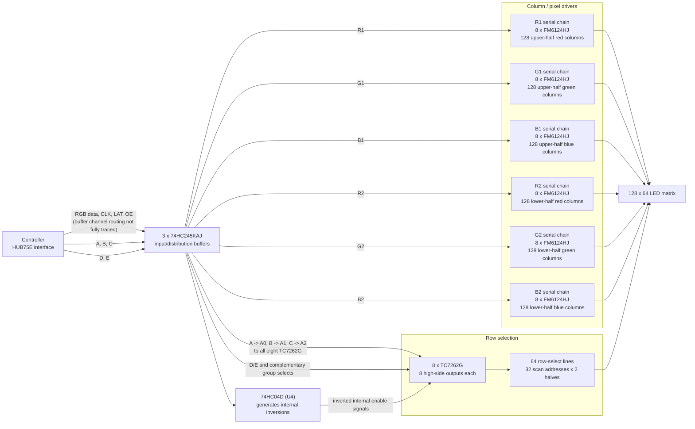

# Schemas

## Nucleo --> HUB75E

The firmware drives two HUB75E panels. GPIOE drives the top panel and GPIOD drives the bottom panel.

Each panel's signals pass through two 74HCT245 buffers for 3.3 V to 5 V logic adjustment before reaching its HUB75E connector.

### Top panel

| **Signal** | **STM32 pin** | **74HCT245** | **Buffer input pin (A)** | **Buffer output pin (B)** | **HUB75E pin** |
| ---------- | ------------- | ------------ | ------------------------ | ------------------------- | -------------- |
| R1         | PE7           | 1            | 2                        | 18                        | 1              |
| G1         | PE8           | 1            | 3                        | 17                        | 2              |
| B1         | PE9           | 1            | 4                        | 16                        | 3              |
| A          | PE10          | 1            | 5                        | 15                        | 9              |
| B          | PE11          | 1            | 6                        | 14                        | 10             |
| C          | PE12          | 1            | 7                        | 13                        | 11             |
| D          | PE13          | 1            | 8                        | 12                        | 12             |
| E          | PE14          | 1            | 9                        | 11                        | 8              |
| CLK        | PE15          | 2            | 2                        | 18                        | 13             |
| LAT        | PE5           | 2            | 3                        | 17                        | 14             |
| OE         | PE6           | 2            | 4                        | 16                        | 15             |
| R2         | PE2           | 2            | 5                        | 15                        | 5              |
| G2         | PE3           | 2            | 6                        | 14                        | 6              |
| B2         | PE4           | 2            | 7                        | 13                        | 7              |

### Bottom panel

| **Signal** | **STM32 pin** | **74HCT245** | **Buffer input pin (A)** | **Buffer output pin (B)** | **HUB75E pin** |
| ---------- | ------------- | ------------ | ------------------------ | ------------------------- | -------------- |
| R1         | PD7           | 1            | 2                        | 18                        | 1              |
| G1         | PD8           | 1            | 3                        | 17                        | 2              |
| B1         | PD9           | 1            | 4                        | 16                        | 3              |
| A          | PD10          | 1            | 5                        | 15                        | 9              |
| B          | PD11          | 1            | 6                        | 14                        | 10             |
| C          | PD12          | 1            | 7                        | 13                        | 11             |
| D          | PD13          | 1            | 8                        | 12                        | 12             |
| E          | PD14          | 1            | 9                        | 11                        | 8              |
| CLK        | PD15          | 2            | 2                        | 18                        | 13             |
| LAT        | PD5           | 2            | 3                        | 17                        | 14             |
| OE         | PD6           | 2            | 4                        | 16                        | 15             |
| R2         | PD2           | 2            | 5                        | 15                        | 5              |
| G2         | PD3           | 2            | 6                        | 14                        | 6              |
| B2         | PD4           | 2            | 7                        | 13                        | 7              |

## Panel

This is the reverse-engineered schema of a 128x64 px panel:

