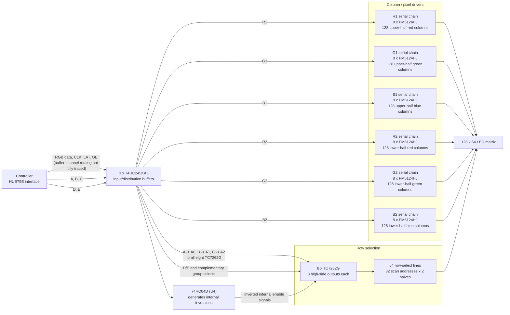

# Schemas

## Nucleo --> HUB75E

The firmware drives two HUB75E panels. GPIOE drives the top panel and GPIOD drives the bottom panel.

Each panel's signals pass through two 74HCT245 buffers for 3.3 V to 5 V logic adjustment before reaching its HUB75E connector.

## NUCLEO-U575ZI-Q --> X-NUCLEO-67W61M1

The ST67W611M1 module uses SPI1 with a separate active-high chip select and two control signals.

| **Signal** | **STM32 pin** | **NUCLEO-U575ZI-Q** | **X-NUCLEO-67W61M1** |
| ---------- | ------------- | ------------------- | -------------------- |
| 5V         | -             | 5V                  | CN6-5 (5V)           |
| GND        | -             | GND                 | CN6-6 (GND)          |
| SCK        | PA5           | CN12-11             | CN5-6 (D13/SCK)      |
| MISO       | PA6           | CN12-13             | CN5-5 (D12/MISO)     |
| MOSI       | PA7           | CN12-15             | CN5-4 (D11/MOSI)     |
| CS         | PD14          | CN12-46             | CN5-3 (D10/CS)       |
| CHIP_EN    | TBD           | TBD                 | CN9-6 (D5)           |
| SPI_RDY    | TBD           | TBD                 | CN9-4 (D3)           |

### Top panel

| **Signal** | **STM32 pin** | **Nucleo header** | **74HCT245** | **Buffer input pin (A)** | **Buffer output pin (B)** | **HUB75E pin** |
| ---------- | ------------- | ----------------- | ------------ | ------------------------ | ------------------------- | -------------- |
| A          | PG0           | CN11-59           | 1            | 5                        | 15                        | 9              |
| B          | PG1           | CN11-58           | 1            | 6                        | 14                        | 10             |
| C          | PG2           | CN11-42           | 1            | 7                        | 13                        | 11             |
| D          | PG3           | CN11-44           | 1            | 8                        | 12                        | 12             |
| E          | PG4           | CN12-69           | 1            | 9                        | 11                        | 8              |
| R1         | PG5           | CN12-68           | 1            | 2                        | 18                        | 1              |
| G1         | PG6           | CN12-70           | 1            | 3                        | 17                        | 2              |
| B1         | PG7           | CN12-67           | 1            | 4                        | 16                        | 3              |
| R2         | PG8           | CN12-66           | 2            | 5                        | 15                        | 5              |
| G2         | PG9           | CN11-63           | 2            | 6                        | 14                        | 6              |
| B2         | PG10          | CN11-66           | 2            | 7                        | 13                        | 7              |
| CLK        | PG12          | CN11-65           | 2            | 2                        | 18                        | 13             |
| LAT        | PG13          | CN11-68           | 2            | 3                        | 17                        | 14             |
| OE         | PG14          | CN12-61           | 2            | 4                        | 16                        | 15             |

### Bottom panel

| **Signal** | **STM32 pin** | **Nucleo header** | **74HCT245** | **Buffer input pin (A)** | **Buffer output pin (B)** | **HUB75E pin** |
| ---------- | ------------- | ----------------- | ------------ | ------------------------ | ------------------------- | -------------- |
| A          | PF0           | CN11-53           | 1            | 5                        | 15                        | 9              |
| B          | PF1           | CN11-51           | 1            | 6                        | 14                        | 10             |
| C          | PF2           | CN11-52           | 1            | 7                        | 13                        | 11             |
| D          | PF3           | CN12-58           | 1            | 8                        | 12                        | 12             |
| E          | PF4           | CN12-38           | 1            | 9                        | 11                        | 8              |
| R1         | PF5           | CN12-36           | 1            | 2                        | 18                        | 1              |
| G1         | PF6           | CN11-9            | 1            | 3                        | 17                        | 2              |
| B1         | PF7           | CN11-11           | 1            | 4                        | 16                        | 3              |
| R2         | PF8           | CN11-54           | 2            | 5                        | 15                        | 5              |
| G2         | PF9           | CN11-56           | 2            | 6                        | 14                        | 6              |
| B2         | PF10          | CN12-42           | 2            | 7                        | 13                        | 7              |
| CLK        | PF12          | CN12-59           | 2            | 2                        | 18                        | 13             |
| LAT        | PF13          | CN12-57           | 2            | 3                        | 17                        | 14             |
| OE         | PF14          | CN12-50           | 2            | 4                        | 16                        | 15             |

## Panel

This is the reverse-engineered schema of a 128x64 px panel:

